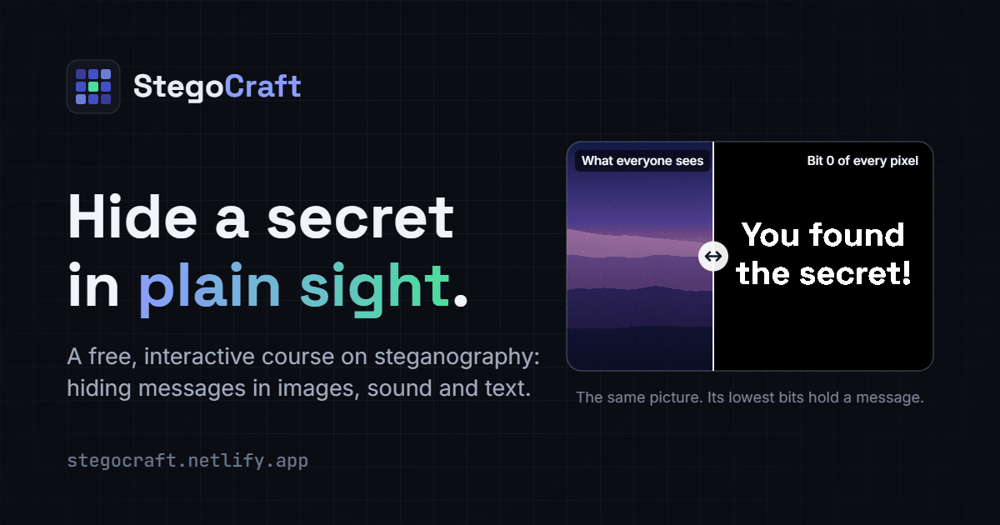

# StegoCraft

**Learn steganography by doing.** StegoCraft is a free, open-source website for learning how to hide messages in
pictures, sound and text — and how hidden messages get caught. Everything runs in the browser: no accounts, no
tracking, no uploads.

[**Open StegoCraft →**](https://stegocraft.netlify.app/) · [Report a bug](https://github.com/SubbSE/StegoCraft1/issues)



## What's inside

| Section        | What you can do                                                                                                                                                                                                                                                        |
| -------------- | ---------------------------------------------------------------------------------------------------------------------------------------------------------------------------------------------------------------------------------------------------------------------- |
| **Learn**      | A course of 14 short lessons in five tracks — foundations, images, sound, text and detection — with 24 interactive experiments and a quiz in every lesson. Progress is saved in your browser.                                                                          |
| **Lab**        | Hide text or whole files in PNG images (1–4 bits per colour value), WAV audio (1–4 bits per sample) and text (invisible Unicode characters or trailing whitespace). Optional password: AES-256-GCM encryption plus password-scattered bit positions. Then reveal them. |
| **Detect**     | Steganalysis for any file: bit-plane viewer, the chi-square attack with a curve that shows how far sequential data reaches, histograms, spectrograms, a digital-silence check, and scans for invisible characters, look-alike letters and hidden whitespace.            |
| **Challenges** | Ten capture-the-flag puzzles, from Easy to Hard, each with hints, a walkthrough and an explanation of how it worked.                                                                                                                                                   |
| **History**    | An interactive timeline, from messages tattooed on a scalp around 499 BCE to malware hidden in the pixels of online adverts.                                                                                                                                           |

Messages are stored as UTF-8, so any language and script — Bengali, Arabic, Chinese, emoji — hides and comes back intact.
The site has light and dark themes, works on phones, and can be used with a keyboard.

## Getting started

You need [Node.js](https://nodejs.org/) 20 or newer.

```bash
git clone https://github.com/SubbSE/StegoCraft1.git
cd StegoCraft1
npm install
npm run dev
```

Then open the address Vite prints (usually http://localhost:5173).

| Command           | What it does                                        |
| ----------------- | --------------------------------------------------- |
| `npm run dev`     | Start the development server                        |
| `npm test`        | Run the unit tests (Vitest)                         |
| `npm run lint`    | Check the code with ESLint                          |
| `npm run build`   | Build the site into `dist/`, including `sitemap.xml` |
| `npm run preview` | Serve the production build locally                  |

## How it works

All processing happens in the browser with standard web APIs: Canvas for pixels, the Web Crypto API for encryption,
and the Web Audio API to decode compressed audio. WAV files are read by StegoCraft's own parser, so every 16-bit sample
is exact.

Every technique hides the same framed bytes:

```
"S" "C" | version | flags | body length (u32) | CRC-32 of body (u32) | body…
```

- **Flags:** bit 0 = encrypted, bit 1 = the body is a file (name and MIME type, then the bytes) rather than UTF-8 text.
- **Passwords:** the body is encrypted with AES-256-GCM using a key derived with PBKDF2-SHA256 (250,000 iterations,
  random 16-byte salt, 12-byte IV). The password also seeds a keyed permutation that scatters the bits across the
  carrier, so without it there's no way to know where to look.
- **Images:** bits go into the lowest bits of the red, green and blue values in reading order (or scattered). Pixels
  that aren't fully opaque are skipped, because browsers store them premultiplied, which would destroy the hidden bits.
- **Reading:** the extractor tries 1–4 bits per value automatically and uses the signature and checksum to tell a real
  message from noise or damage.

## Project structure

```
src/
├── lib/            Core steganography, crypto, DSP and analysis code (no React; unit-tested)
├── content/
│   ├── lessons/    One module per lesson: the lesson body plus its quiz
│   └── challenges/ One module per challenge: builds its file, story, hints, walkthrough and debrief
├── explorables/    The interactive experiments used inside lessons
├── components/     UI, layout, media viewers, and the Lab, Detect and Challenge tools
├── pages/          One component per route
└── hooks/          Theme, progress, page metadata and other shared hooks
scripts/            Maintenance scripts
```

### Adding a lesson

Create `src/content/lessons/<slug>.jsx` that default-exports the lesson body and exports a `quiz` array, then add an
entry to `LESSONS` in `src/content/lessons/index.js`. The sitemap picks it up automatically.

### Adding a challenge

Create `src/content/challenges/<id>.jsx` (see the existing ones: it exports `make()`, a default `Story`, `hints`,
`Walkthrough` and `Debrief`) and add it to `CHALLENGES` in `src/content/challenges/index.js`. Answers are stored only as
hashes, and secret texts are base64-encoded so that browsing the source doesn't spoil a puzzle by accident:

```bash
npx vite-node --root . scripts/challenge-answer.mjs <challenge-id> "<answer>" "<optional secret text>"
```

## Deploying

The repository includes a `netlify.toml` with the build command, the single-page-app redirect and security headers.
Any static host works: build with `npm run build`, serve `dist/`, and send unknown paths to `index.html`.

## Team

StegoCraft began as our final-year capstone project.

| Name            | Role                    |
| --------------- | ----------------------- |
| Sayan Basak     | Lead Developer          |
| Subir Ghosh     | Cryptography Specialist |
| Sriparna Biswas | UI/UX Designer          |
| Ankan Jash      | Backend Architect       |

## Further reading

The full reading list is on the [About page](https://stegocraft.netlify.app/about#references). A few good starting
points:

- David Kahn, _The Codebreakers: The Story of Secret Writing_ (1967; revised 1996).
- F. A. P. Petitcolas, R. J. Anderson and M. G. Kuhn, “Information Hiding — A Survey”, _Proceedings of the IEEE_ 87(7), 1999.
- A. Westfeld and A. Pfitzmann, “Attacks on Steganographic Systems”, _Information Hiding 1999_, Springer LNCS 1768.
- J. Fridrich, _Steganography in Digital Media: Principles, Algorithms, and Applications_, Cambridge University Press, 2009.

## Acknowledgements

Fonts: [Inter](https://rsms.me/inter/), [Space Grotesk](https://floriankarsten.com/space-grotesk) and
[JetBrains Mono](https://www.jetbrains.com/lp/mono/) (SIL Open Font License), self-hosted via
[Fontsource](https://fontsource.org/). Icons: [Lucide](https://lucide.dev/) (ISC License).

## Use it responsibly

Steganography protects privacy, and it is also used to hide malware and stolen data. Learn it to understand, protect
and defend, and only analyse files you have the right to examine.
